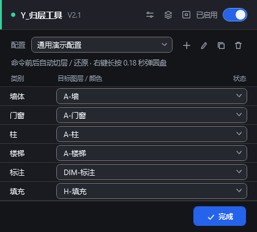
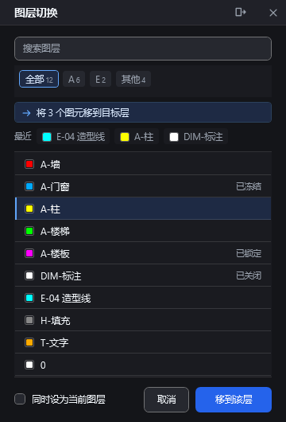
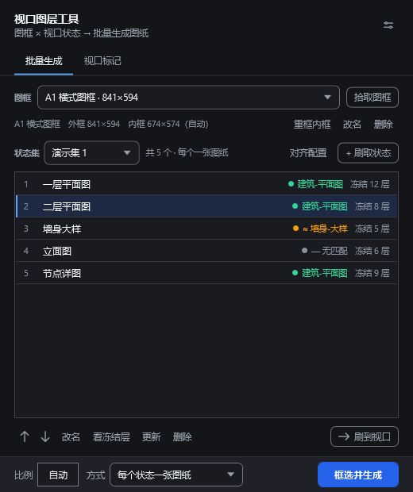
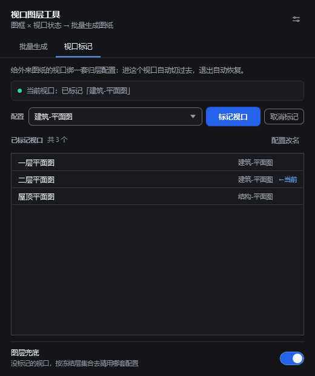
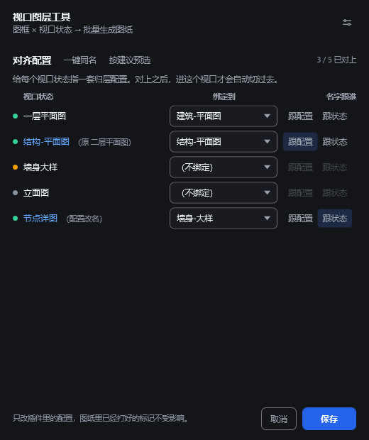
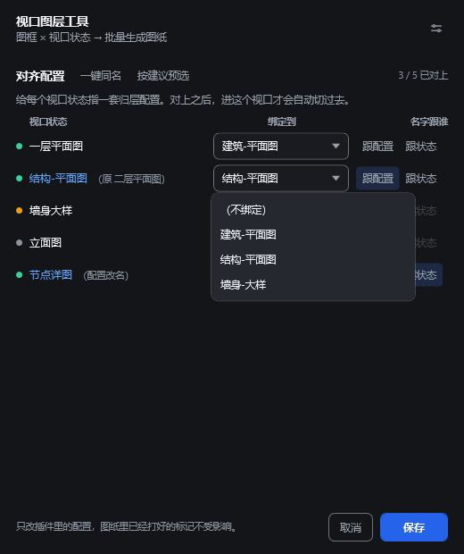
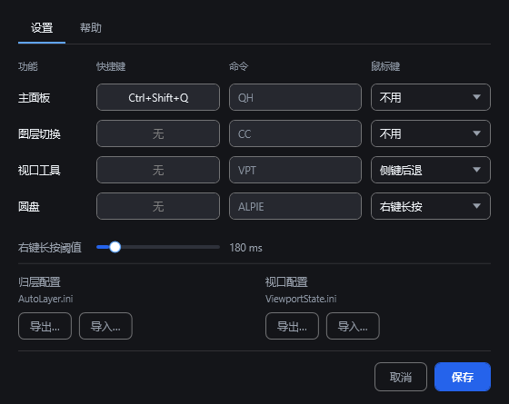

# Y_归层工具 V2.1

> AutoCAD 绘图辅助插件 —— 自动归层、图层切换、视口图层状态，一个 DLL 三套能力。

适用 **AutoCAD 2016 ~ 2026（64 位）**　|　编译基线 **.NET Framework 4.5 + AutoCAD 2016 API (20.1)**　|　界面 **WPF 深色主题**

画图时按图元类型自动落到对应图层；需要手动改层时敲 `CC` 弹面板选；出图时按视口冻结层批量套用图层状态。
三套功能共用一个程序集、一份 `AutoLayer.ini`，V1.0 的老配置直接沿用。

---

## 界面

| 归层配置面板 `QH` | 图层切换面板 `CC` |
|---|---|
|  |  |

| 视口工具 · 批量生成 `VPT` | 视口工具 · 视口标记 |
|---|---|
|  |  |

**对齐配置**（V2.1 新增，面板内浮层，不再甩回命令行）：

| 状态 → 配置 对齐 | 选择配置层 |
|---|---|
|  |  |

**总设置窗口 `ALSET`**（功能 / 快捷键 / 命令 / 鼠标键，一行一个功能）：



> 以上界面取自工程内 `ui-preview` 对实际 XAML 的离屏渲染，示例数据为演示配置。

---

## 三套能力

### 1. 自动归层

画图时按**图元类型**把新图元自动落到指定图层。默认**停用**，不配置就完全不介入。

- 规则按图元类别映射（墙体 / 门窗 / 柱 / 楼梯 / 标注 / 填充……），一个类别对一层
- 命中前先过 `RuleResolver` 过滤，只有真的命中类别才开事务，不拖慢每条命令
- 命令行 `ALON` / `ALOFF` / `ALTOGGLE` 切换；`ALSTATUS` 打印当前映射表，`ALTRACE` 看最近几次归层记录

### 2. 图层切换（`CC`）

选中物体 → `CC` → 选目标图层 → 图元挪过去。图上已有的东西乱了，用它救回来。

- 搜索框输图层名或首字母，`↑↓` 选、`Enter` 确认、`Esc` 取消、双击也能确认
- 鼠标划过图层 = 在图纸里**预亮**该层所有图元（最多 500 个）
- 「最近使用」横排在列表上方，单击只看、双击应用
- 不选物体直接敲 `CC` = 只切当前图层，并给「回到上次选中（N 个）」一键回归
- 列表开虚拟化，1000 个图层打开约 20 ms

### 3. 视口图层状态（`VPT`）

1. **刷取视口** —— 记下某个视口里被冻结的图层名（跨图纸按名匹配），刷取即绑定归层配置
2. **批量生成** —— 按图框内框铺视口，每个状态一张图纸，或一个布局横排多个
3. **进视口自动切配置** —— 视口上带标签（句柄 → 配置名），进去自动切、退出恢复

V2.1 在此基础上加了：

- **状态集**：一个公司 / 项目一套状态，组间允许重名，刷取 / 生成 / 对齐只作用于当前集
- **自动绑定**：状态名和配置名完全一致时自动绑，不用再手动标一次
- **图层兜底**：视口没标签时，拿冻结层集合去状态列表里找完全一致的那个状态（可关）
- **对齐配置**：面板内浮层，一行一个状态，「跟配置」/「跟状态」两个方向按钮决定名字往哪边走

> 标签存在图纸命名对象字典的**一条 Xrecord**（`AUTOLAYER_VP_TAG`）里，不出现在 LIST / 特性 / 打印里，
> 不生成实体和图层。没装插件的人看不出区别，也不需要保存以外任何操作。

---

## 安装

### 方式一：安装器（推荐）

1. 到 [**Releases**](https://github.com/CC-haihai/Y_GCGJ/releases/latest) 下载 `Y_GCGJ_V2.1.zip` 并解压（包内是 `Y_归层工具V2.1/` 目录）
2. **关掉 AutoCAD**
3. 双击 `Y_归层工具V2.1_安装器.exe`
4. 勾上要用的 AutoCAD 版本 → 点「应用更改」→ 启动 CAD

命令行出现下面这行就算装好了：

```
Y_归层工具 V2.1  已加载（自动归层 + 图层切换 + 视口）
```

再敲 `QH` 和 `CC` 各试一下，两个面板能弹出来就对了。

> 首次运行 Windows 可能提示「已保护你的电脑」→ 更多信息 → 仍要运行。
> 没有代码签名证书时这是正常提示，不是病毒。杀软拦截时改用 `安装.bat`（纯文本脚本）。

### 方式二：手动 NETLOAD

解压后把 `Y_归层工具V2.1.dll` 放到固定目录，CAD 里敲 `NETLOAD` 选中它。
这种方式不写注册表、不装到 CAD 目录，适合便携或测试。

### 升级注意

- **换过 DLL 必须重启 AutoCAD**。插件程序集名固定（`AutoLayer`），CAD 加载过一次之后再换文件，
  .NET 会复用旧程序集，表现就是「明明换了却没变化」。
- **两个版本不能在同一 CAD 里同时启用**。命令名完全重名（`QH` / `CC` / `ALSET` / `VPT`…），
  后加载的会被拒。往新版走没问题（装新版会自动摘掉旧版注册），往旧版退**必须先卸新版**。
- 从 **V1.0** 升上来：直接装 V2.1 即可，安装器会自动摘掉旧版的加载注册，装完重启 CAD。
  `AutoLayer.ini` 文件名和格式没变，旧配置直接沿用（安装器也会把旧配置复制到固定目录，不覆盖已有的）。

---

## 命令

共 **29 个**命令、**6 个**界面资源。

### 归层（13）

| 命令 | 作用 |
|---|---|
| `QH` | 打开 / 关闭归层配置面板 ← 平时最常用 |
| `ALON` / `ALOFF` / `ALTOGGLE` | 启用 / 停用 / 来回切自动归层 |
| `ALSET` | 设置窗口（快捷键 / 鼠标键 / 命令名 / 配置导入导出 / 帮助） |
| `ALPIE` | 手动弹一次圆盘 |
| `ALSTATUS` | 打印当前状态和映射表 ← 排障先看这个 |
| `ALKEY` | 快捷键为什么不响应 |
| `ALMOUSE` | 圆盘 / 侧键为什么不响应 |
| `ALTRACE` | 最近几次归层记录 ←「刚才那条线为什么去了那层」 |
| `ALEDIT` | 在资源管理器里定位配置文件 |

### 图层切换（2）

| 命令 | 作用 |
|---|---|
| `CC` | 选中物体后弹出图层面板 |
| `CCHELP` | 图层切换的用法说明 |

### 视口工具（16）

| 命令 | 作用 |
|---|---|
| `VPT` / `VLPANEL` | 打开视口工具面板 |
| `VLHELP` | 视口工具用法说明 |
| `VLCAP` | 刷取当前视口的冻结层（刷取即绑定） |
| `VLAPPLY` | 把某个状态应用到当前视口 |
| `VLUPDATE` | 更新已有状态（重新刷取） |
| `VLBATCH` | 批量生成布局与视口 |
| `VLLIST` / `VLDEL` | 列出 / 删除状态 |
| `VLFRAME` | 拾取图框 |
| `VLINNER` | 重框内框 |
| `VLLIB` | 扫描 dwg 目录批量导入图框（命令行版） |
| `VLTAG` / `VLUNTAG` / `VLTAGS` | 标记视口 / 取消标记 / 体检 |
| `VLALIGN` | 对齐配置（命令行版，面板内浮层是主路径） |

### 自定义命令名与鼠标键

四个入口（主面板 `QH` / 图层切换 `CC` / 视口工具 `VPT` / 圆盘 `ALPIE`）都能在 `ALSET` 里再起一个自定义名，
两个名字同时有效。也可以把功能绑到鼠标上：

- 右键**长按**触发（短按照旧是 CAD 原生右键菜单），阈值 100–800 ms 可调，默认 180
- 侧键按下即触发
- 一颗键只能绑一个功能，选新的会把原来那个顶掉
- 命令进行中不触发，避免打断正在执行的命令

---

## 配置文件

| 文件 | 装什么 | 安装器位置 |
|---|---|---|
| `AutoLayer.ini` | 映射表、开关、快捷键、命令名、鼠标绑定 | `%LOCALAPPDATA%\YGuiCeng\AutoLayer.ini` |
| `ViewportState.ini` | 图框、视口状态、状态集 | 同目录 |

纯文本，记事本能改，改完重启 CAD 生效。手动 NETLOAD 时优先读 DLL 同目录，不可写退回
`%APPDATA%\AutoLayer\AutoLayer.ini`。

**导出 / 导入**在设置窗口底部：技术负责人配好映射表 → 导出一份 ini → 群里发 → 全组各自导入。
导入是整体替换，导入前会自动备份成 `AutoLayer.ini.导入前备份`。

常用配置项：

```ini
面板命令 = QH                  ; 主面板的自定义命令名
切层命令 = CC                  ; 图层切换的自定义命令名
切层同时设为当前 = 是 / 否
最近图层 = A ; B ; C           ; 前面的是最近的
```

---

## 兼容性与限制

- **AutoCAD 2016 ~ 2026（64 位）**，32 位 CAD 不支持
- 需要 .NET Framework 4.5+（Win10/11 自带 4.8，不用另装）
- 圆盘的「毛玻璃」是抓屏模糊做的，远程桌面 / 虚拟机里可能吃力
- 同时开多个 CAD 窗口时，配置以「最后关面板的那个」为准，建议只在一个窗口里改配置
- 视口标签需要保存图纸才持久化；`WBLOCK` 分发会丢（丢了只是不切配置，不坏图）

**为什么能兼容 2016 及以上**：`acdbmgd` / `acmgd` / `accoremgd` 都不是强名称程序集，
CLR 只按简单名绑定、不校验版本，所以用 2016 的引用编出来的 DLL 能被高版本 CAD 直接加载。
反过来不行 —— 用高版本引用编，到 2016 上会抛 `MissingMethodException`。

---

## 从源码编译

```bash
dotnet build 源码/Plugin/Y_CADToolbox.csproj -c Release
```

产物 `源码/bin/Y_归层工具V2.1.dll`。程序集名是 ASCII 的 `AutoLayer`，交付文件另存一份中文名
（WPF 的 BAML 资源路径对非 ASCII 程序集名不友好）。

`refs/` 里是 AutoCAD 2016 (20.1) 的托管程序集，来自 Autodesk 官方 NuGet 包：

```bash
nuget install AutoCAD.NET        -Version 20.1.0   # AcMgd / AdWindows / AcCui
nuget install AutoCAD.NET.Core   -Version 20.1.0   # AcCoreMgd
nuget install AutoCAD.NET.Model  -Version 20.1.0   # AcDbMgd
```

没有 `refs/` 时工程会退回本机 CAD 安装目录（`CadInstallDir`，默认 `AutoCAD 2021`）——
**那样编出来的只能在高版本 CAD 上用**，只在临时验证时这么干。

### 界面预览（不启动 CAD）

```bash
dotnet run --project ui-preview/UiPreview.csproj -- 输出.png 520 620 vp
```

第四参数可选 `cc` / `panel` / `settings` / `vp`，冒号后接状态：
`vp:empty` `vp:tag` `vp:align` `vp:alignpick` `settings:help` 等。
桩代码只提供 XAML 事件签名，不引 AutoCAD，纯排版核对用。

### 源码结构

```
源码/
  Core/           归层引擎 + 全部命令（只依赖 acdbmgd / accoremgd）
  UI/             WPF：主面板 / 状态条 / 右键圆盘 / 设置 / 图层切换
  ViewportTool/   视口图层状态（VpCommands / VpBatch / VpStore / FrameLib / Ui/VpPanel）
  Plugin/         Y_CADToolbox.csproj，单文件工程，一起编成 AutoLayer.dll
 安装器/          安装器工程（自包含内嵌 DLL）
refs/             AutoCAD 2016 托管程序集（编译用）
ui-preview/       离屏界面渲染桩
design/           界面设计规格文档
docs/images/      README 用截图
安装包/           已编译的 DLL + 安装器 zip
```

改代码前建议先读 [`源码/README.md`](源码/README.md)，里面有性能热路径、已踩过的坑、
WPF 初始化时序问题等实现层面的约定。

---

## 出问题先查这几条

| 现象 | 处理 |
|---|---|
| 敲 `QH` 提示「未知命令」 | 没加载上。重开安装器看那个 CAD 是否显示「已安装」，勾上再点「应用更改」，然后彻底关闭重开 CAD |
| 换了 DLL 没变化 | 没重启 CAD。程序集名固定，必须重启 |
| 自动归层不生效 | 默认是停用状态，`ALON` 打开，或 `ALSTATUS` 看映射表 |
| 快捷键没反应 | 敲 `ALKEY` 自检；快捷键必须带 Ctrl 或 Alt |
| 圆盘 / 侧键没反应 | 敲 `ALMOUSE` 自检 |
| 进视口没切配置 | `VLTAGS` 体检：配置名是否还在、视口是否关着、有没有打标记 |

---

## 交流与反馈

问题、建议、要新版，都进 QQ 群：

**QQ 群：2166082781**

群里会同步版本更新和已知问题。提问题时附上 CAD 版本号 + `ALSTATUS` 输出，定位会快很多。

## 关于

本工具为个人业余作品，**仅作交流学习使用**。不保证后续版本更新，也不对使用过程中产生的问题承担责任。

如果它帮你省了点时间，可以请作者喝杯咖啡 ☕


扫码随意，金额不限，心意为主。

## 许可

本项目采用 [**PolyForm Noncommercial License 1.0.0**](LICENSE)：允许个人非商业使用、
修改和分发，**不得用于商业目的**。分发时须随附本许可条款。

第三方组件（StarPie 的扇区几何实现，MIT）与 `refs/` 下 Autodesk 程序集的声明，
见 [THIRD-PARTY-NOTICES.md](THIRD-PARTY-NOTICES.md)。
